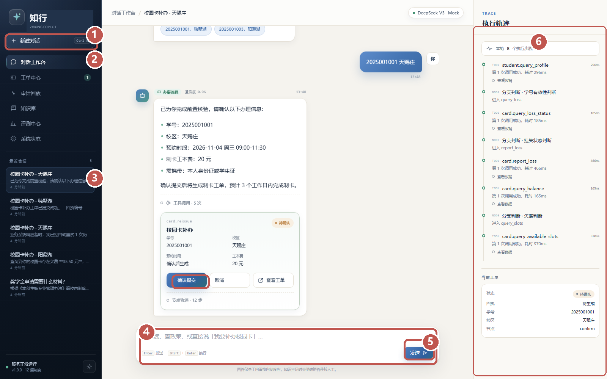
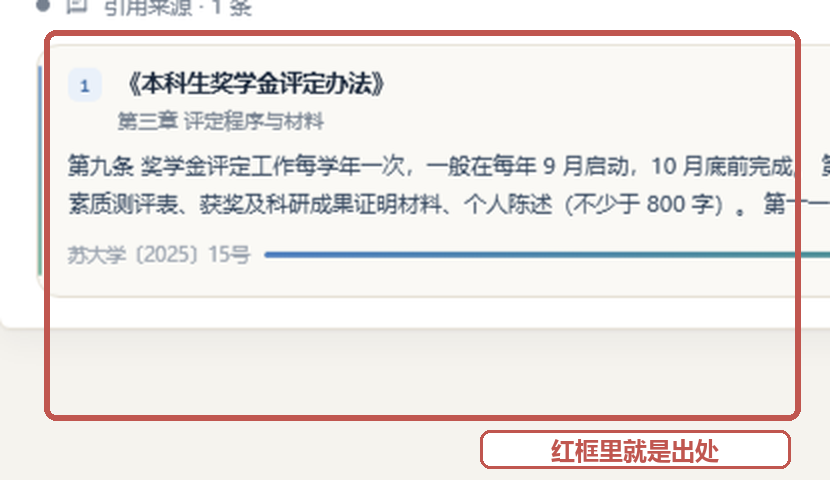
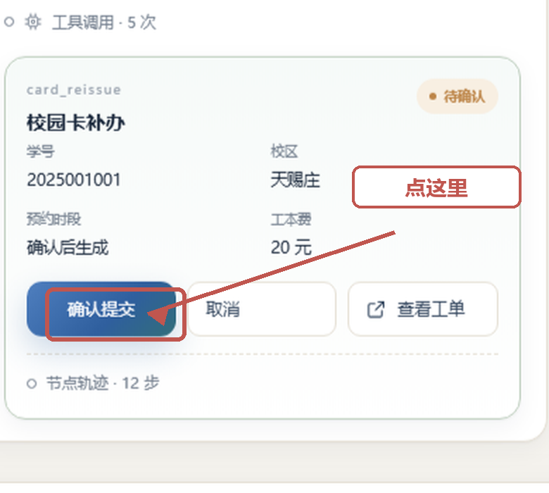
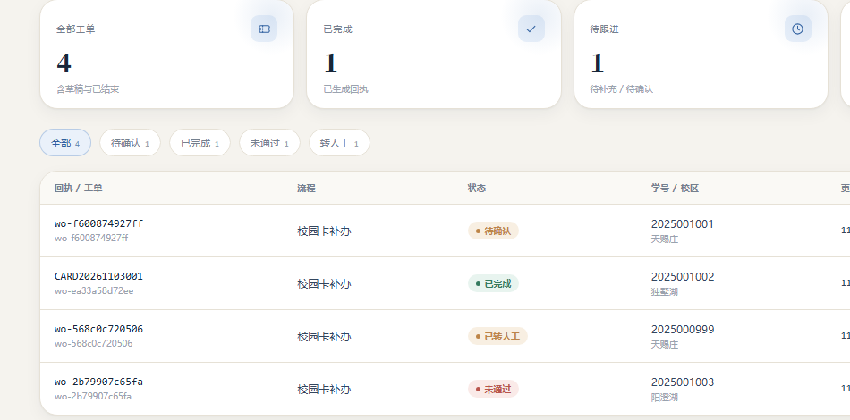
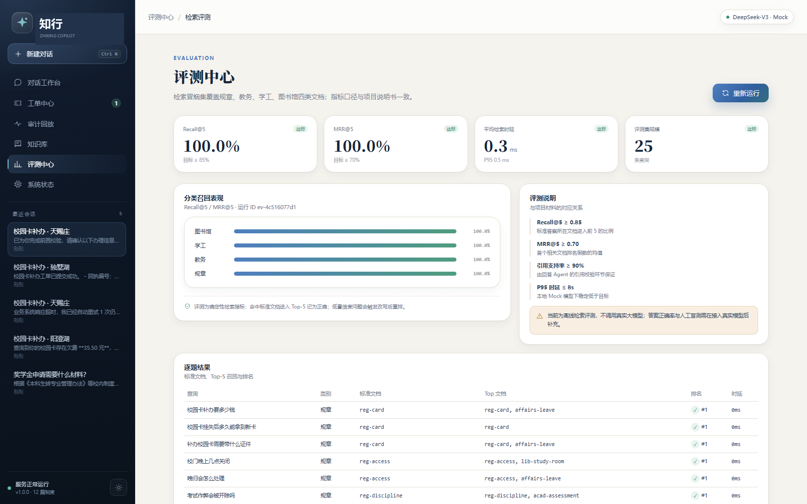

# 知行 · 校园智能服务助手

## 零基础演示脚本

> 照着念、照着点，8 分钟完成演示。
>
> 团队：嵇杨健、陈昱麒、王祥晔 ｜ 指导教师：刘 安 ｜ v1.1 · 2026 年 11 月

---

# 先看这一页

这份脚本是给**第一次上台、不熟悉计算机**的同学准备的。你不需要懂技术，只需要会三件事：

- 用鼠标左键点按钮。
- 在白色的输入框里打字。
- 按键盘上的回车键（Enter）。

> **记住｜整场只需要 5 个动作**
>
> 登录用「管理员」演示账号 → 问一个问题 → 点一下引用 → 办一张校园卡 → 点确认 → 看工单。其他页面都是给老师看的，时间不够可以跳过。

**如果出错超过 30 秒，不要修。** 直接打开 docs/screenshots 文件夹，用截图继续讲。后面“出问题怎么办”那一页写了具体怎么做。

> **提示｜不要背技术名词**
>
> 你不需要说“RAG、向量、阈值、幂等”。照着加粗的字念就行。老师问技术细节时，把问题转给团队里负责技术的同学。

整场 8 分钟，建议这样分配。时间不够就砍掉追问和评测，保住问答、补办、回执。

| 时间 | 这一段 | 你要做什么 |
| --- | --- | --- |
| 0:00–2:00 | 问答 + 引用 | 问奖学金材料，点 [1] 看原文 |
| 2:00–3:30 | 追问 + 拒答 | 问转专业，再问一个它不会的火锅 |
| 3:30–6:30 | 补办 + 回执 | 新建对话，输 2025001011，确认提交 |
| 6:30–8:00 | 工单 + 评测 | 看节点轨迹，切评测中心，收尾 |

# 上台前 20 分钟：照着这张表做

| 时间 | 你要做什么 | 看到什么算成功 |
| --- | --- | --- |
| T-20 | 双击项目文件夹里的 START_DEMO.bat | 会弹出一个黑色窗口，然后浏览器打开登录页 |
| T-15 | 点「工作人员」→「管理员」 | 进入工作台；左下角显示“系统管理员” |
| T-10 | 把“提词卡”那一页打印，或存到手机里 | 手边有输入顺序 |
| T-5 | 插好投屏线，按 Win+P 选择“复制” | 投影上出现和电脑一样的画面 |
| T-5 | 浏览器按 Ctrl+0，恢复 100% 大小 | 字不重叠、不超出屏幕 |
| T-2 | 看左侧会话列表 | 有 5 个会话，最新一个是“校园卡补办 · 天赐庄” |
| T-0 | 深呼吸，开始念开场白 | 计时 8 分钟 |

**学生登录**：切到「学生登录」，输入名册中的学号、姓名和学号后六位；演示主线仍用管理员账号。

**个人中心**：左下角点姓名，可看个人资料、切换账户、退出登录。

**演示开始前，桌面上只留 3 样东西：**

- 浏览器窗口：地址是 127.0.0.1:8011，不要用百度去搜。
- 黑色服务窗口：标题是 Campus Agent Server，最小化即可，不要关。
- 打印出来的提词卡：放在键盘旁边，演示时只看它。

> **注意｜三个不要**
>
> 不要关掉黑色服务窗口；不要自己安装或更新任何软件；不要删除 data 文件夹。

> **提示｜找不到 START_DEMO.bat**
>
> 它在项目文件夹最外层，和 app、docs 在同一个地方。提前让技术同学把它放到桌面，并自己双击试一次。

# 屏幕上都是什么

下面这张图里，红圈是你需要认识的区域。你实际只会用到 1、4、5。



*图 1 演示界面地图（红圈对应下表）*

| 编号 | 名称 | 你要用它做什么 |
| --- | --- | --- |
| 1 | 新建对话 | 每演示一个新话题，先点它，避免和上一段混在一起 |
| 2 | 左侧导航 | 切到工单中心、审计回放、评测中心 |
| 3 | 最近会话 | 不用点；老师问“刚才的记录呢”时指一下 |
| 4 | 输入框 | 点一下，光标闪了再打字 |
| 5 | 发送按钮 | 也可以直接按回车键 |
| 6 | 执行轨迹 | 不用操作，指给老师看“每一步都有记录” |

**中间的白色卡片**是工单确认卡，确认按钮在卡片最下面，下一页有放大图。

# 开场 30 秒 + 第一个问题

**你站着说：**

> **提示｜开场白（可以照着念）**
>
> 老师好，我演示的是校园智能服务助手。它做两件事：第一，回答校园制度问题，每句话都能找到出处；第二，直接办理校园卡补办，最后给回执。下面我用 8 分钟走一遍。

| 步骤 | 你做什么 | 屏幕上会出现什么 |
| --- | --- | --- |
| 1 | 点左上角的「新建对话」 | 中间变成欢迎页，左侧多一个会话 |
| 2 | 点页面最下面的白色输入框 | 输入框边框变蓝，光标在闪 |
| 3 | 用键盘输入：奖学金申请需要什么材料？ | 字出现在输入框里 |
| 4 | 按回车键（Enter），或点蓝色「发送」 | 出现“正在识别意图…” |
| 5 | 等 2 到 3 秒，不要连续点 | 出现 3 条带 [1] 的回答，下面有一张引用卡片 |

**你指着回答说：**“每条结论后面的 [1] 就是出处；下面这张卡片写着文件名、章节和文号。”



*图 2 引用卡片：红框里就是回答的依据*

**再点一下正文里的 [1]，或点卡片右下角「查看原文」**，让老师看到原文。

> **注意｜如果没反应**
>
> 先等 3 秒；只点一次发送；还不行按 F5 刷新页面。不要连续点十几次。

# 追问一句，再问一个它不会的

**第一句，输入：**

```text
转专业需要什么条件？
```

你会看到它给出绩点 3.0、无不及格、年级等条件。

**第二句，输入：**

```text
转专业学生呢
```

它会记得上一句在问转专业，继续回答具体门槛。你指着右侧说：“它记得上下文。”

**第三句，输入：**

```text
学校附近有什么好吃的火锅
```

它会说“没有找到可靠的校内依据”，给出学生工作部电话，并且**没有引用**。

**你这样说：**“它不是什么都答。找不到依据就拒答并转人工，避免编造制度。”

> **提示｜时间够再加一句**
>
> 输入“奖学金是不是挂科也能拿”，它会先纠正“这个说法不准确”，再引用正确条款。

这三句话，分别让老师看到三件事：

| 你输入 | 证明给老师看 |
| --- | --- |
| 转专业需要什么条件？ | 回答有依据，不是随口说 |
| 转专业学生呢 | 它记得上一句，能多轮追问 |
| 学校附近有什么好吃的火锅 | 知道边界，找不到依据就不编 |

# 补办：从输入到确认

这一段是整场最重要的。**只用 2025001011 这个学号**，不要用 2025001002。

| 步骤 | 你输入什么 | 屏幕上会出现什么 |
| --- | --- | --- |
| 1 | 点「新建对话」，输入：我要补办校园卡 | 它问你要学号和校区，并给出示例 |
| 2 | 故意输错：2025001，独墅湖 | 它提醒“学号不是 10 位数字”，停在原步骤 |
| 3 | 输入正确的：2025001011，天赐庄 | 出现确认卡片：学号、校区、预约时段、20 元、身份证 |
| 4 | 指着卡片说：写入前必须人工确认 | 卡片状态是“待确认” |

**确认卡片长这样，红框里是你要点的按钮：**



*图 3 确认卡片（示意；你操作时学号会显示 2025001011）*

> **注意｜唯一需要记住的学号**
>
> 完整办理用 2025001011，天赐庄。它已经挂失、没有欠费，所以能一次走完。如果它提示“今天已经提交过”，说明这个学号今天用过了，换 2025001008，或双击 START_DEMO.bat 重来。

# 点确认、拿回执、看工单

| 步骤 | 你做什么 | 屏幕上会出现什么 |
| --- | --- | --- |
| 1 | 点红框里的「确认提交」 | 按钮变灰，出现“正在提交” |
| 2 | 等 1 到 2 秒 | 出现回执编号 CARD 开头，状态“已完成”，显示取卡地点 |
| 3 | 点回执旁边的复制图标（可选） | 右上角提示“已复制到剪贴板” |
| 4 | 点「查看工单」 | 右侧打开抽屉：节点轨迹、审计留痕 |
| 5 | 用鼠标滚轮往下滚一点 | 能看到“参数抽取→校验学籍→查挂失→查欠费→确认→提交→回执” |

**你这样说：**“一次对话，替代原来跑三个窗口。回执编号可以拿去取卡，也可以在工单中心查。”

> **注意｜如果看不到确认按钮**
>
> 把鼠标放到聊天区域，往下滚一格滚轮；卡片在消息最下面。

**回执出来以后，指给老师看这 3 个地方：**

| 位置 | 说明 |
| --- | --- |
| 回执编号（CARD 开头） | 这是取卡凭据，也可以拿去窗口查询 |
| 状态“已完成” | 说明系统真的生成了工单，不是只回一句“好的” |
| 取卡地点 / 时间 | 告诉用户下一步去哪里、什么时候去 |

# 给老师看证据：工单中心 + 审计回放

## 工单中心

| 步骤 | 你点什么 | 屏幕上会出现什么 |
| --- | --- | --- |
| 1 | 点左侧「工单中心」 | 四张统计卡：全部、已完成、待跟进、异常与转人工 |
| 2 | 点「已完成」筛选 | 只剩已完成的工单 |
| 3 | 点 2025001002 那一行 | 右侧抽屉：回执、学号/校区、预约时段、取卡地点 |
| 4 | 展开「节点轨迹」 | 每一步的名称、耗时、状态 |

## 审计回放

点左侧「审计回放」→ 把事件类型筛选为「工具调用」→ 随便展开一条。你不必读 JSON，只说一句：

> **记住｜这一段的唯一台词**
>
> “每个关键动作都能在审计里找到对应的输入、输出和时间，所以出了问题可以回放。”



*图 4 工单中心：状态统计、筛选和办理记录*

# 可选：学生库（1 分钟）

如果老师问“这些学生数据从哪来”，点左侧「学生库」。这个入口只有管理员、辅导员、审计员可见；用管理员登录即可。时间不够可以跳过，不影响主线。

| 步骤 | 你做什么 | 屏幕上会出现什么 |
| --- | --- | --- |
| 1 | 点左侧「学生库」 | 361 条学生、1 个学院、1 届、10 个班、2 个专业 |
| 2 | 专业筛选选“计算机科学与技术” | 剩下 162 条 |
| 3 | 搜索框输入：2527405001，按回车 | 出现该生的姓名、班级、届别；手机号显示为 136****7843 |
| 4 | 把筛选切回“全部专业” | 恢复 361 条 |

**你这样说：**“这是从 Excel 导入的 25 届计科院名册。换一个学院或一届，只要再导入一次，不用改代码。”

> **提示｜学生库的边界**
>
> 姓名、班级、专业来自名册；校园卡挂失和余额仍是模拟数据。手机号只显示前三位和后四位，原始号码不通过页面暴露。

如果老师追问“换一个学院怎么办”，把这条命令指给他看：

```text
python scripts/import_students.py \
  --file students_2026_business.xlsx \
  --cohort 2026 --college 商学院
```

# 评测中心 + 收尾

点左侧「评测中心」，指一下四个数字：

- Recall@5：100%——25 道测试题都能找到正确的制度文件。
- MRR@5：100%——正确文件基本都排在第一位。
- 平均时延：不到 1 毫秒——这是本地检索，不含模型生成。
- 评测集：25 条——覆盖规章、教务、学工、图书馆四类。

**你这样说：**“这是检索测试，不是答案准确率。目标是 85%，目前全部命中；答案质量还要靠引用校验和人工评测。”

> **提示｜收尾白（照着念）**
>
> 以上就是演示：有依据、能办事、可追溯。谢谢老师。



*图 5 评测中心：四个指标和逐题结果*

# 如果只有 5 分钟

| 时间 | 你做什么 | 一句话 |
| --- | --- | --- |
| 0:00 | 点「管理员」登录，打开工作台 | “一个工作台，问答、办事、审计都在里面。” |
| 0:30 | 输入：奖学金申请需要什么材料？ | “每个结论都有出处。” |
| 1:30 | 点 [1] / 查看原文 | “可以回到制度原文。” |
| 2:30 | 新建对话 → 我要补办校园卡 → 2025001011，天赐庄 | “它先核对，再让我确认。” |
| 4:00 | 点确认提交 | “一次对话拿到回执。” |
| 4:30 | 点查看工单 | “每一步都能查。” |
| 5:00 | 切评测中心，收尾 | “检索目标 85%，目前全部命中。” |

**如果只有 3 分钟，只做这 4 步：**

- 问一个奖学金问题，点一下 [1]，说“每个结论都有出处”。
- 新建对话，输入「我要补办校园卡」，再输入 2025001011，天赐庄，点确认。
- 点查看工单，说“每一步都能查”。
- 说收尾白，结束。

> **提示｜压缩版的原则**
>
> 宁可少讲一个场景，也不要加快语速。老师听不清，讲再多也没用。

> **记住｜5 分钟版只讲三句话**
>
> 有出处、有回执、能回放。把这三句讲清楚，比把六个页面都点一遍更有效。

# 老师可能问的 8 个问题

| 老师问 | 你就这样答 |
| --- | --- |
| 这是真的系统吗？ | 是能跑的原型。制度文本和演示会话是模拟的，但学生名册、问答、补办、回执、审计流程都是真的。 |
| 为什么不用真的大模型？ | 为了现场稳定、不联网。模型接口已经留好，换成真模型不用改流程。 |
| 它会不会胡说？ | 找不到校内依据就拒答；回答必须带引用，引用对不上会重新生成或转人工。 |
| 能办别的事吗？ | 目前只开通校园卡补办，其他事项转人工。这是故意的范围控制，先把一条流程做扎实。 |
| 重复提交怎么办？ | 同一天、同一学号只生成一张工单，再提交会返回原来的回执。 |
| 数据安全吗？ | 演示会话和一卡通状态是模拟的；25 届计科院名册是课程授权导入的，页面只显示脱敏手机号，原始号码不出服务端。 |
| 你和团队做了什么？ | 我负责演示和流程验证，技术实现由团队共同完成；具体模块我可以请负责的同学补充。 |
| 下一步做什么？ | 接真实模型和校园业务系统，扩大评测集，再开通更多办事流程。 |

> **提示｜不会答时的统一话术**
>
> “这个问题涉及实现细节，我请负责这块的同学补充一下。”说完就把话筒递过去，不要硬编。

# 出问题怎么办

| 你看到的现象 | 先做什么 | 还不行怎么办 |
| --- | --- | --- |
| 浏览器打不开 / 一片空白 | 看黑色 Campus Agent Server 窗口还在不在 | 双击 START_DEMO.bat，等 15 秒；再不行用截图 |
| 输入后没反应 | 等 3 秒，按一次回车 | 按 F5 刷新；仍不行用截图 |
| 出现“今天已经提交过” | 这是正常现象，不是报错 | 换 2025001008，或双击 START_DEMO.bat |
| 看不到确认按钮 | 鼠标放到聊天区，往下滚一格 | 点右侧“执行轨迹”下方，找到当前工单 |
| 投影上字太小 | 浏览器按 Ctrl 和加号两下 | 按 Ctrl+0 恢复 |
| 投影没有画面 | 按 Win+P，选“复制” | 换一根 HDMI 线或找现场老师 |
| 说错一句话 | 不要重复道歉，继续下一步 | 老师没注意到，别主动回头解释 |
| 系统卡住超过 30 秒 | 不要现场修 | 打开 docs/screenshots，用 01、02、03 截图继续讲 |

> **注意｜兜底原则**
>
> 演示不是考试。超过 30 秒没恢复，就切截图，把时间留给“为什么这样设计”。

**上台前，把这 4 样东西放在手边：**

| 应急物品 | 放在哪里 | 什么时候用 |
| --- | --- | --- |
| 打印的提词卡 | 键盘旁边 | 忘记下一步时，低头看一眼 |
| docs/screenshots 文件夹 | 桌面快捷方式 | 系统卡住，切图片继续讲 |
| 这份 DEMO_GUIDE.pdf | 手机里 | PDF 可以放大，随时查步骤 |
| 技术同学电话 | 手机通讯录 | 超过 2 分钟没恢复，直接打电话 |

# 绝对不能做的 7 件事

- 不要用 2025001002 演示完整补办——它今天已经提交过，会直接返回旧回执。
- 不要连续用同一个学号演示两次完整补办——第二次一定命中重复提交。
- 不要关掉黑色 Campus Agent Server 窗口——关了网页就打不开。
- 不要删除 data 文件夹——删了数据就没了；要重来就双击 START_DEMO.bat。
- 不要现场安装、更新 Python 或浏览器。
- 不要说“准确率 100%”——100% 是 25 道检索题，不是所有问题。
- 不要和报错较劲超过 30 秒。

**如果已经发生了，按这张表补救，不要慌：**

| 已经发生的事 | 怎么补救 |
| --- | --- |
| 用了 2025001002 演示补办 | 换 2025001008 再走一次；或者直接说“这张是预置回执，我们换一张新卡” |
| 连续用了 2025001011 两次 | 第二次会返回原回执；换 2025001008，或双击 START_DEMO.bat |
| 关掉了黑色服务窗口 | 双击 START_DEMO.bat，等 15 秒，网页会重新打开 |
| 删掉了 data 文件夹 | 双击 START_DEMO.bat，它会重新生成演示数据 |

> **记住｜记住**
>
> 重置不丢人。现场能继续讲下去，比“保住刚才那一步”重要得多。

# 一页纸提词卡（打印这一页）

把这一页放在手边，演示时只看这一页。

| 顺序 | 你输入 / 你点 | 你说 |
| --- | --- | --- |
| 开场 | — | “它做两件事：回答有出处，办事有回执。” |
| 问答 | 奖学金申请需要什么材料？ | “每个结论都有 [1] 出处。” |
| 引用 | 点 [1] / 查看原文 | “可以回到制度原文。” |
| 追问 | 转专业需要什么条件？ → 转专业学生呢 | “它记得上一句。” |
| 拒答 | 学校附近有什么好吃的火锅 | “找不到依据就拒答，不编。” |
| 补办 | 新建 → 我要补办校园卡 → 2025001011，天赐庄 | “先核对，再让我确认。” |
| 确认 | 点「确认提交」 | “一次对话拿到回执。” |
| 工单 | 点「查看工单」 | “每一步都能查。” |
| 评测 | 点「评测中心」 | “25 题全命中，目标 85%。” |
| 收尾 | — | “有依据、能办事、可追溯。谢谢老师。” |

> **提示｜紧张时就说这三句**
>
> ①“这一步我换个方式展示”，然后切截图。②“这个问题请负责技术的同学补充”，把话筒递过去。③“我们先把主线走完，细节会后交流”，继续下一页。

# 数据小抄 + 一键重来

| 你想演示 | 用这个学号 | 会看到 |
| --- | --- | --- |
| 完整办成（推荐） | 2025001011，天赐庄 | 确认卡片 → 回执 |
| 完整办成（备用） | 2025001008，独墅湖 | 确认卡片 → 回执 |
| 自动挂失 | 2025001006，独墅湖 | 轨迹里出现 report_loss |
| 欠费拦截 | 2025001010，独墅湖 | 欠费 8.50 元，工单失败 |
| 工具超时 | 2025000999，独墅湖 | 重试后转人工 |
| 学号无效 | 2025009999，独墅湖 | 提示学号错误 |
| 取消办理 | 左侧预置会话「校园卡补办 · 天赐庄」→ 取消 | 状态变为已取消 |

## 两个双击就能用的文件

| 文件 | 什么时候双击 | 会发生什么 |
| --- | --- | --- |
| START_DEMO.bat | 每次上台前 | 自动关旧服务、清数据、重启、生成演示数据、打开网页 |
| OPEN_DEMO.bat | 演示中途网页被关了 | 只重新打开网页，不动数据 |

> **记住｜重来一次**
>
> 双击 START_DEMO.bat，等浏览器自动打开。看到左侧 5 个会话，就是准备好了。
